<div class="cover">
<div class="institution">Universidade Tecnológica Federal do Paraná<br>Engenharia de Software</div>
<div class="author">Eduardo Caversan</div>
<div class="title">EcoWatt</div>
<div class="subtitle">Monitoramento de Consumo Energético Residencial</div>
<div class="description">Relatório técnico da atividade <strong>Operação Deploy — Do código à produção</strong>, da disciplina de Gerência de Configuração e Manutenção de Software.<br><br>Professora: Eduarda Maganha de Almeida<br>Modalidade: trabalho individual</div>
<div class="date">Entrega prevista: 25 de novembro de 2026<br>Versão técnica do documento: 24/11/2026</div>
</div>

<div class="toc-page">
<div class="toc-title">Sumário</div>
<ol>
<li><a href="#1-identificacao-do-projeto-e-da-equipe">Identificação do projeto e da equipe</a></li>
<li><a href="#2-introducao-e-contextualizacao">Introdução e contextualização</a></li>
<li><a href="#3-escopo-e-funcionalidades-da-aplicacao">Escopo e funcionalidades da aplicação</a></li>
<li><a href="#4-tecnologias-e-ambiente-de-desenvolvimento">Tecnologias e ambiente de desenvolvimento</a></li>
<li><a href="#5-organizacao-do-trabalho-e-gerencia-de-configuracao">Organização do trabalho e gerência de configuração</a></li>
<li><a href="#6-construcao-do-pipeline-de-ci">Construção do pipeline de CI</a></li>
<li><a href="#7-plano-e-execucao-dos-testes-automatizados">Plano e execução dos testes automatizados</a></li>
<li><a href="#8-entrega-continua-artefato-e-publicacao">Entrega contínua, artefato e publicação</a></li>
<li><a href="#9-simulacao-de-falha-bloqueio-e-recuperacao">Simulação de falha, bloqueio e recuperação</a></li>
<li><a href="#10-resultado-final-e-rastreabilidade">Resultado final e rastreabilidade</a></li>
<li><a href="#11-dificuldades-decisoes-e-aprendizados">Dificuldades, decisões e aprendizados</a></li>
<li><a href="#12-consideracoes-finais">Considerações finais</a></li>
<li><a href="#13-referencias-e-declaracao-de-uso-de-ferramentas">Referências e declaração de uso de ferramentas</a></li>
</ol>
<p>O sumário contém links internos. A numeração das páginas aparece no rodapé. Capturas, logs e metadados completos acompanham este documento em <code>docs/evidencias/</code>.</p>
<div class="note">Documento destinado à revisão acadêmica final. RA, turma e campus não foram informados. A aprovação prévia do tema próprio pela professora não foi confirmada. Esses itens não são presumidos como concluídos.</div>
</div>

# 1. Identificação do projeto e da equipe

| Campo | Identificação |
|---|---|
| Instituição | Universidade Tecnológica Federal do Paraná — UTFPR |
| Curso | Engenharia de Software |
| Disciplina | Gerência de Configuração e Manutenção de Software |
| Professora | Eduarda Maganha de Almeida |
| Acadêmico | Eduardo Caversan |
| RA, turma e campus | Não informados; preencher após conferência do acadêmico |
| Projeto | EcoWatt — Monitoramento de Consumo Energético Residencial |
| Identificação da equipe | EcoWatt — Projeto Individual |
| Atividade | Operação Deploy — Do código à produção |
| Data limite | 25/11/2026 |
| Apresentações previstas | 25 e 26/11/2026; duração máxima de 12 minutos |

O trabalho é individual e não possui outros integrantes. As responsabilidades acadêmicas de desenvolvimento, integração, testes, pipeline, qualidade, documentação e apresentação são atribuídas a Eduardo Caversan, com apoio das ferramentas declaradas na seção 13. Os registros do Git utilizam a identidade já configurada no ambiente; não foram criados autores ou revisores fictícios.

A implementação foi conduzida com automação e ferramentas de inteligência artificial. A revisão final do código, dos resultados, do documento e a compreensão necessária à defesa oral ainda dependem do acadêmico. A conclusão técnica não comprova que essa revisão pessoal já ocorreu.

O tema de sustentabilidade é uma proposta própria. A aprovação prévia pela professora é uma responsabilidade do acadêmico e não foi confirmada no contexto disponível. A entrega no Moodle também permanece sob sua responsabilidade; não foi efetuada pela automação.

O critério de aceitação usado foi a rubrica fornecida para a atividade: aplicação (15), controle de versão (10), CI (20), CD (20), falha e recuperação (10), documentação (10) e apresentação (15). Esses pesos orientaram as verificações; nenhuma nota acadêmica foi atribuída ao projeto.

# 2. Introdução e contextualização

O consumo energético residencial resulta da utilização de equipamentos com potências e tempos de funcionamento diferentes. Embora a fatura apresente o consumo agregado, ela não explica diretamente a participação de cada aparelho. Uma estimativa simples pode ajudar o consumidor a compreender quais grupos de equipamentos têm maior impacto sobre o total mensal.

O EcoWatt permite informar potência, tempo médio diário e quantidade de aparelhos. A aplicação apresenta consumo em quilowatt-hora, custo em reais e distribuição proporcional. Seu público-alvo são consumidores residenciais interessados em interpretar o uso de energia de forma acessível. A tarifa é informada manualmente, porque não existe integração com concessionárias.

O objetivo da solução é apoiar a compreensão do consumo estimado, sem prometer medição física ou precisão equivalente à fatura. Potência constante e mês de 30 dias são hipóteses explícitas. Equipamentos com ciclos de funcionamento, variações de carga e cobranças adicionais podem produzir diferenças em relação ao resultado apresentado.

O objetivo acadêmico é demonstrar um processo rastreável de construção, integração, testes, entrega e publicação. A aplicação foi mantida pequena para que o comportamento relevante e a relação entre cada etapa do pipeline fossem facilmente verificáveis. O sucesso não se limita à existência de arquivos YAML ou testes: as execuções remotas e a versão pública foram efetivamente consultadas.

Na gerência de configuração, os commits, branches, pull requests, lockfile, workflow e tag identificam estados reproduzíveis do produto. Na manutenção, a regressão controlada mostra como uma alteração aparentemente pequena pode quebrar uma regra existente. Os testes fornecem uma referência objetiva; as dependências entre jobs impedem que esse estado avance para a publicação.

O processo observado culminou em três execuções distintas na main: aprovação inicial, falha funcional e recuperação. A seção 9 relaciona cada execução ao commit e ao conteúdo público observado, distinguindo resultado do teste, artefato produzido e versão efetivamente entregue.

# 3. Escopo e funcionalidades da aplicação

## 3.1 Funcionalidades implementadas

O cadastro contém UUID, nome, potência em watts, horas diárias e quantidade. A inclusão válida atualiza imediatamente a tabela, os indicadores, as barras e a persistência. A tabela apresenta os dados informados, consumo mensal, custo e ação de exclusão. A exclusão exige confirmação e permite cancelamento sem alterar os dados.

A tarifa inicial é R$ 0,90/kWh, apresentada como exemplo ilustrativo. Ao confirmar uma nova tarifa, todos os custos são recalculados e a configuração é persistida. O resumo contém quantidade total de unidades, consumo total, custo total e grupo de maior consumo. Em caso de empate, a redução mantém o primeiro grupo com o maior valor. As barras representam a participação percentual no consumo total; não utilizam bibliotecas de gráficos.

A aplicação inicia sem equipamentos e apresenta um estado vazio. Os dados usados nas imagens foram cadastrados em contextos de teste do navegador; não compõem dados permanentes ou pré-carregados do produto.

| Cenário executado | Potência | Horas/dia | Quantidade | Consumo | Custo a R$ 0,90/kWh |
|---|---:|---:|---:|---:|---:|
| A — Aquecedor | 1.500 W | 4 | 1 | 180 kWh | R$ 162,00 |
| B — Lâmpadas | 100 W | 5 | 3 | 45 kWh | R$ 40,50 |
| C — Total | — | — | 4 | 225 kWh | R$ 202,50 |

```javascript
const consumption = (powerWatts / 1000) * dailyHours * quantity * 30;
const cost = consumption * tariff;
```

Os resultados intermediários não são arredondados. A apresentação usa `Intl.NumberFormat` em português brasileiro; o formato monetário apresenta centavos. As somas são feitas sobre os valores numéricos originais.

<figure class="figure-small">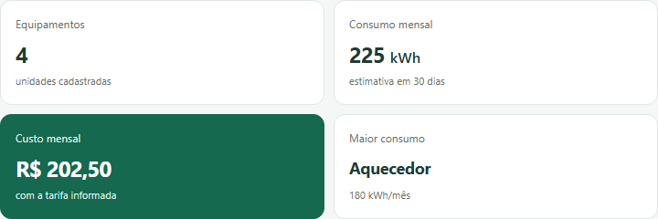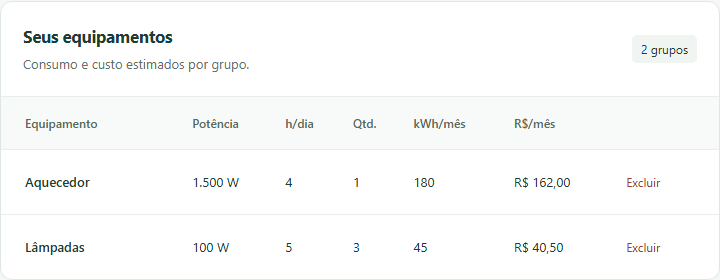<figcaption>Figura 1 — Recortes reais da aplicação publicada: quatro unidades, consumo total de 225 kWh e custo de R$ 202,50. Os valores foram verificados por assertions de interface. Fonte: captura real via Playwright.</figcaption></figure>

## 3.2 Validação, persistência e experiência de uso

Nome é obrigatório, não pode conter apenas espaços e admite até 100 caracteres. Potência e tarifa devem ser números finitos estritamente positivos. Horas devem estar no intervalo (0, 24], aceitando frações. Quantidade deve ser um inteiro positivo seguro. A aplicação rejeita resultados não finitos, underflow para zero e totais incompatíveis com o intervalo suportado.

A chave `ecowatt:v1` armazena um documento JSON com `schemaVersion`, `equipment` e `tariff`. Na recuperação, além do parse, são verificadas a estrutura, a versão do esquema, os identificadores únicos e as regras de negócio. Ausência da chave inicia um estado vazio. Conteúdo vazio, JSON inválido ou estrutura incompatível não são sobrescritos silenciosamente: o usuário recebe um aviso e precisa confirmar o descarte. Falhas de acesso ou quota permitem utilização temporária, com mensagem explícita de que a alteração não foi persistida.

Entradas textuais são renderizadas com `textContent`, sem interpretar HTML fornecido pelo usuário. Labels, foco visível, regiões de status e erro e tabela com cabeçalhos dão suporte à acessibilidade básica. A tabela possui rolagem horizontal interna em telas estreitas. Os testes de navegador verificam desktop a 1440 × 1000 e mobile a 390 × 844, incluindo ausência de transbordamento da página.

<figure class="figure-small">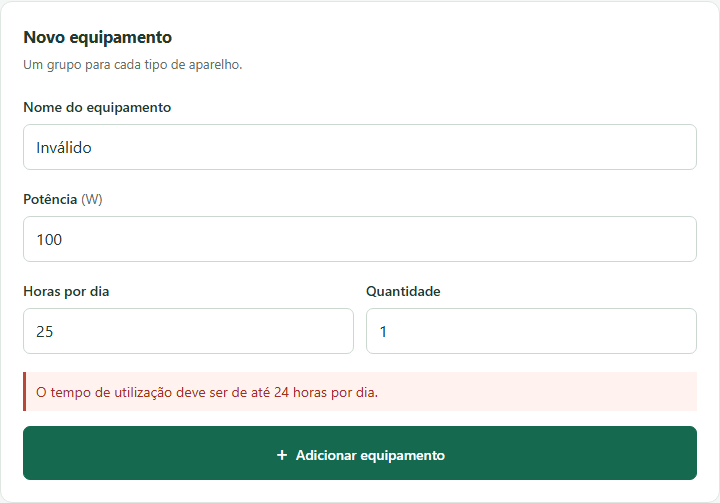<figcaption>Figura 2 — Validação real: utilização de 25 horas é rejeitada e não cria um terceiro registro. A tarifa já foi alterada para R$ 1,20; o total correto é R$ 270,00. Fonte: captura real da versão publicada.</figcaption></figure>

O escopo não inclui backend, autenticação, banco remoto, sincronização, medidores inteligentes, leitura de faturas ou consulta de tarifas. Esses recursos não são apresentados como implementados.

# 4. Tecnologias e ambiente de desenvolvimento

| Tecnologia | Versão observada | Finalidade |
|---|---|---|
| HTML5 / CSS3 / JavaScript | Padrões web; ES Modules | Estrutura, apresentação e comportamento |
| Node.js local | 22.12.0 | Execução das ferramentas; linha LTS suportada |
| Node.js no CI | 22.23.5 | Ambiente configurado pela action, linha 22 |
| NPM local | 10.9.0 | Dependências e scripts |
| Vite | 8.3.8 | Desenvolvimento e build estático |
| Vitest | 5.1.1 | Testes de regras e armazenamento |
| Playwright Test | 1.65.1 | Testes em Chromium, evidências e impressão do PDF |
| Git | 2.48.1.windows.1 | Histórico e integração de código |
| GitHub CLI | 2.105.0 | PRs, configuração e coleta de execuções |
| GitHub Actions / Pages | Serviços gerenciados | CI/CD e hospedagem pública |
| Python Markdown / PyMuPDF | 3.11.3 / 2.1 | Conversão do relatório e inspeção do PDF |

O desenvolvimento ocorreu em Windows com PowerShell. Os runners do workflow usam `ubuntu-latest`. As dependências diretas estão fixadas no `package.json` e as transitivas no `package-lock.json`. A instalação local informou zero vulnerabilidades naquele momento; isso é um resultado pontual da consulta, não uma garantia permanente de segurança.

A arquitetura estática elimina a necessidade de servidor próprio, credenciais de aplicação, Docker e infraestrutura paga. O navegador calcula e persiste os dados. Node.js é usado na construção e nos testes; a aplicação publicada contém apenas arquivos estáticos.

Para reproduzir, instale Node.js 22 LTS em versão igual ou superior a 22.12 e NPM. Na raiz do projeto:

```bash
npm ci
npm test
npm run build
npm run dev
```

O desenvolvimento fica em `http://127.0.0.1:5173/ecowatt/`. `npm run preview` serve o build em `http://127.0.0.1:4173/ecowatt/`. O Vite usa `base: '/ecowatt/'` para compatibilidade com o subdiretório do Pages. Para os testes de interface, execute `npx playwright install chromium` e `npm run test:ui` após o build. O `npm test` executa uma vez e termina com código de saída adequado.

# 5. Organização do trabalho e gerência de configuração

O repositório público é [EduardoCaversan/ecowatt](https://github.com/EduardoCaversan/ecowatt). A branch principal é `main`. O projeto é individual: a integração foi feita pelo próprio responsável, sem simular revisões independentes. As descrições dos PRs informam mudanças e validações realizadas.

```text
.github/workflows/ci-cd.yml   # quatro jobs de CI/CD
src/energy.js                # regras e validações puras
src/storage.js               # persistência e proteção de dados
src/main.js, styles.css      # interface
tests/*.test.js              # 19 testes Vitest
tests/ui/app.spec.js         # 5 testes Playwright
scripts/generate-version.js  # metadados reais do build
docs/                       # relatório, auditoria e evidências
index.html, public/          # entrada HTML e favicon
package.json, package-lock.json
vite.config.js, playwright.config.js, README.md
```

| Branch / PR | Alterações reais | Integração |
|---|---|---|
| `feature/energy-calculator` — [PR #1](https://github.com/EduardoCaversan/ecowatt/pull/1) | Regras de consumo/custo e 14 testes iniciais | Merge commit |
| `feature/equipment-management` — [PR #2](https://github.com/EduardoCaversan/ecowatt/pull/2) | Persistência, interface e verificação de navegador | Merge commit |
| `feature/ci-cd` — [PR #3](https://github.com/EduardoCaversan/ecowatt/pull/3) | Workflow, rastreabilidade e CSS legível | Merge commit após CI aprovado |
| `demo/pipeline-failure` — [PR #4](https://github.com/EduardoCaversan/ecowatt/pull/4) | Regressão acadêmica de 30 para 31 dias | Integração controlada, após registrar falha |
| `fix/monthly-consumption` — [PR #5](https://github.com/EduardoCaversan/ecowatt/pull/5) | Restauração de 30 dias, sem alterar testes | Merge commit após CI aprovado |

O primeiro commit definiu o projeto e escopo. Os commits seguintes registraram incrementos efetivamente implementados e verificados. Não foram utilizados commits vazios, alteração de datas, force push ou reescrita para esconder a regressão. As referências das branches permanecem no remoto.

<figure class="figure-small">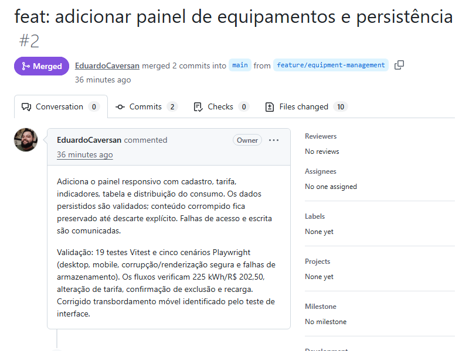<figcaption>Figura 3 — PR real de equipamentos, com dois commits de implementação e integração na main. A página mostra ausência de revisores, coerente com a modalidade individual.</figcaption></figure>

## 5.1 Histórico e linha de base entregue

Exemplos representativos: `e31c495` inicializa o escopo; `1f46df1` implementa regras e testes; `54c6a68` protege a persistência; `7e82b5f` adiciona a interface; `96c5840` configura CI/CD. O histórico completo, incluindo merges e demonstração, está em `evidencias/git-log.txt` e no GitHub.

<figure class="figure-small">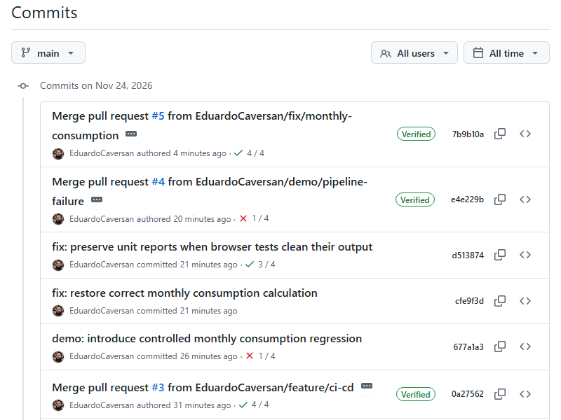<figcaption>Figura 4 — Histórico real ao consolidar as evidências técnicas: evolução, regressão e correção permanecem rastreáveis. Commits documentais posteriores são consultáveis no mesmo histórico.</figcaption></figure>

<figure class="figure-small">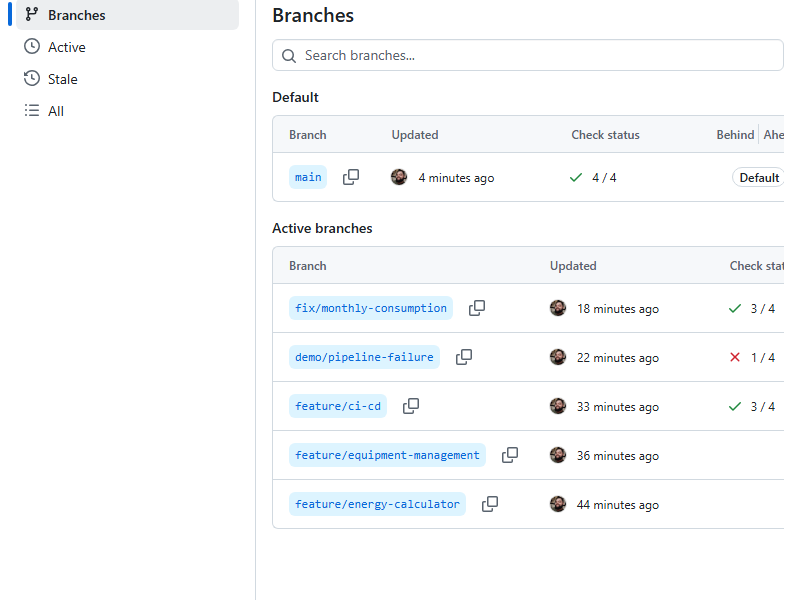<figcaption>Figura 5 — Branches de desenvolvimento e demonstração preservadas para avaliação. Não representam integrantes ou equipes fictícias.</figcaption></figure>

A tag anotada `v1.0.0` aponta para o commit funcional corrigido `7b9b10a7ef2493f01aa6c03ca377c22c80bd0092`, efetivamente publicado. A documentação é consolidada depois dessa linha de base. Alterações exclusivas em `docs/` e `README.md` não disparam o workflow, conforme `paths-ignore`. O SHA final do repositório pode, portanto, diferir do SHA publicado sem alterar o produto entregue. A identificação exata do commit documental final está no arquivo externo `Links-Entrega.txt`, evitando autorreferência infinita no relatório.

# 6. Construção do pipeline de CI

O workflow versionado em `.github/workflows/ci-cd.yml` é acionado por push na main, pull request direcionado à main e execução manual. Há quatro jobs identificáveis. A relação implementada é:

<div class="diagram"><span>Build</span>→<span>Test</span>→<span>Package</span>→<span>Deploy</span></div>

Além da sequência mostrada, Package declara dependência direta de Build e Test. Quando Test falha, os jobs posteriores são ignorados. Em PR, o pacote é validado e o deploy é inelegível. Na main, o deploy ocorre automaticamente após os pré-requisitos aprovados.

```yaml
on:
  push:
    branches: [main]
    paths-ignore: ['docs/**', 'README.md']
  pull_request:
    branches: [main]
    paths-ignore: ['docs/**', 'README.md']
  workflow_dispatch:
# Dependências reais dos jobs:
test:
  needs: build
package:
  needs: [build, test]
deploy:
  needs: package
  if: github.ref == 'refs/heads/main' && github.event_name != 'pull_request'
```

O trecho destaca configurações do arquivo; o YAML completo no repositório contém os blocos `jobs`, steps, ações e permissões. Build e Test fazem checkout do mesmo commit de execução e usam `npm ci`. Build gera `dist/`, valida arquivos essenciais e verifica o SHA em `version.json`. Test executa o Vitest, recupera o build, confere integridade e executa o Playwright sobre esse build. Não há reconstrução entre validação e pacote.

São utilizadas releases oficiais fixadas: checkout 7.0.1, setup-node 7.1.0, upload-artifact 7.0.2, download-artifact 8.0.2, upload-pages-artifact 5.0.0 e deploy-pages 5.0.1. As versões foram consultadas no GitHub durante a execução. O runner fornece Node para as actions e setup-node configura a linha 22 para o projeto.

A permissão padrão é `contents: read`. Somente Deploy recebe `pages: write` e `id-token: write`. O ambiente é `github-pages`. A concorrência por workflow/ref e o grupo de deploy impedem publicações concorrentes conflitantes; não se cancela uma execução em andamento. Não há `continue-on-error` nem comandos que transformem testes reprovados em sucesso. `if: always()` é usado apenas para preservar os resultados do job Test.

<figure class="figure-small">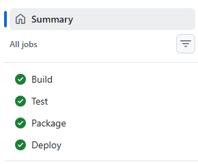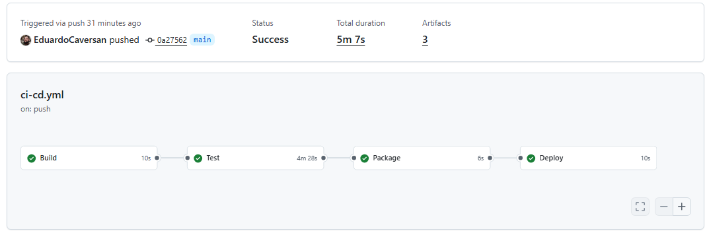<figcaption>Figura 6 — Execução inicial na main: quatro jobs aprovados e artefatos registrados. A captura corresponde à execução 45315409008.</figcaption></figure>

# 7. Plano e execução dos testes automatizados

Foram implementados **19 testes Vitest** e **cinco testes Playwright**, totalizando 24 casos declarados. Os testes usam funções efetivamente chamadas pela aplicação. Loops de entradas inválidas agrupam variações de uma mesma regra sem inflar artificialmente a quantidade de casos. O estado final aprovou 19/19 no Vitest e 5/5 no Playwright, localmente, no CI e na verificação da interface pública aplicável.

| ID | Comportamento e dados | Resultado esperado | Resultado final obtido |
|---|---|---|---|
| T01 | 1500 W, 4 h, 1 unidade | 180 kWh | 180; aprovado |
| T02 | 1000 W, 0,5 h | 15 kWh; conversão W/kW | 15; aprovado |
| T03 | Cenário A, tarifa 0,90 | R$ 162,00 | 162; aprovado |
| T04 | 100 W, 5 h, 3 unidades | 45 kWh / R$ 40,50 | 45 / 40,5; aprovado |
| T05 | Grupos A e B | 225 kWh / R$ 202,50 / 4 unidades | Valores exatos; aprovado |
| T06 | B, A e lista vazia | A maior; vazia com totais zero | Resultado esperado; aprovado |
| T07 | Nome vazio, espaços, 101 caracteres e null | Rejeição | Exceções observadas; aprovado |
| T08 | Potência 0, negativa, NaN, infinita e ausente | Rejeição | Exceções observadas; aprovado |
| T09 | Horas 0, negativas, 24,1 e não finitas; limite 24 | Rejeição inválidas; 1080 kWh no limite | Resultado esperado; aprovado |
| T10 | Quantidade 0, negativa, fracionária e insegura | Rejeição | Exceções observadas; aprovado |
| T11 | Tarifa não positiva, vazia, null ou não finita | Rejeição | Exceções observadas; aprovado |
| T12 | Excluir A da lista A+B | 45 kWh / R$ 40,50 / 3 unidades; original intacto | Resultado esperado; aprovado |
| T13 | A+B com tarifa 1,20 | 225 kWh / R$ 270,00 | Resultado esperado; aprovado |
| T14 | Overflow, underflow, total inseguro e consumo pequeno | Rejeitar limites; preservar 0,0054 de custo | Resultado esperado; aprovado |
| T15 | Salvar e recuperar documento válido | Mesmos equipamentos e tarifa | Igualdade estrutural; aprovado |
| T16 | Chave de armazenamento ausente | Lista vazia e tarifa 0,90 | Resultado esperado; aprovado |
| T17 | JSON vazio/inválido e esquema incompatível | Preservar, bloquear e liberar só após reset | Conteúdo preservado; aprovado |
| T18 | Acesso negado e quota de escrita | Avisar/lançar erro sem fingir salvamento | Resultado esperado; aprovado |
| T19 | Equipamento persistido com 25 h | Não gravar | Chave continua ausente; aprovado |

## 7.1 Verificações de interface e resultados preservados

| ID | Procedimento real | Resultado esperado e obtido |
|---|---|---|
| UI01 | Fluxo completo desktop, cenários A/B/C, tarifa, exclusão, recarga e versão | HTTP 200, cálculos exatos, persistência e SHA coerente; aprovado |
| UI02 | Mesmo fluxo em 390 × 844 | Interação funcional e sem transbordamento da página; aprovado |
| UI03 | JSON corrompido, descarte cancelado/confirmado e nome com marcação HTML | Preservação e renderização textual sem execução; aprovado |
| UI04 | Getter LocalStorage lança SecurityError | Sessão temporária com aviso; aprovado |
| UI05 | Escrita lança QuotaExceededError | Aviso explícito e nenhuma falsa confirmação de persistência; aprovado |

O teste de interface verifica status HTTP, ausência de erros no console e exceções de página, atualização de indicadores, rejeição de 25 horas, alteração de tarifa, cancelamento e confirmação de exclusão, persistência após recarga e correspondência entre rodapé e `version.json`. A barra do aquecedor é verificada em 80% no cenário C.

Os testes de armazenamento usam uma implementação em memória da API chave/valor para controlar falhas de forma determinística. Isso não substitui as regras reais: `createStorage`, `validateState` e `summarize` são executadas. O Playwright também testa persistência real em navegador e injeta especificamente falhas de acesso/quota para validar o tratamento dessas exceções.

Vitest gera `test-results/unit.json` e `unit.xml`. Playwright gera `ui.json`, `ui.xml` e trace/screenshot em falha. O CI preserva os arquivos no artefato `resultados-testes-<SHA>`, inclusive quando Vitest termina reprovado. A preservação não altera o código de saída do teste. Cópias locais e remotas acompanham as evidências, além dos logs completos. Na execução inicial, a limpeza padrão do Playwright removeu os arquivos unitários antes do upload; os resultados unitários desse run estão nos logs, e os equivalentes locais foram preservados. A configuração final usa `test-results/browser` para os arquivos de execução do navegador, conservando os quatro relatórios no artefato da recuperação.

Na regressão controlada, 9 dos 19 testes Vitest falharam. O T01 indicou 186 kWh em vez de 180 kWh. Os testes de interface não foram executados nessa execução reprovada, pois a etapa anterior já falhou; eles não são contados como aprovados ou executados no cenário B. A seção 9 detalha o encadeamento observado.

# 8. Entrega contínua, artefato e publicação

O build é produzido uma única vez por execução. O script de versão registra versão do pacote, SHA completo, horário UTC, identificador do run e indicação de alterações locais. No CI, `GITHUB_SHA` e `GITHUB_RUN_ID` vêm do ambiente de execução. Em builds locais, o script consulta o Git; em uma extração sem `.git`, informa `local-sem-git` de forma explícita.

Build publica `build-intermediario-<SHA>`, contendo `dist/` e `SHA256SUMS.txt`. Esse artefato existe mesmo quando os testes posteriores falham. Ele é insumo de validação, não autorização de entrega. Test e Package verificam os hashes dos arquivos antes de utilizá-los.

Depois da aprovação, Package usa `actions/upload-pages-artifact` e produz `github-pages`, um arquivo no formato esperado pelo Pages. Deploy depende desse pacote e usa a action oficial para publicá-lo. Na recuperação, o artefato final tem identificador **14885569757**, vinculado ao run **45318646338**. Metadados completos e o conteúdo baixado estão em `evidencias/runs/recuperacao/`.

**Integração contínua (CI)** corresponde à integração e verificação automatizada do código. **Entrega contínua (Continuous Delivery)** prepara uma versão validada, pronta para ser publicada. **Implantação contínua (Continuous Deployment)** publica essa versão automaticamente segundo as regras do ambiente. No EcoWatt, Package representa a preparação da entrega e Deploy publica automaticamente a main aprovada. PRs executam as verificações sem alterar a produção.

O Pages foi configurado com `build_type: workflow` e HTTPS. A inspeção identificou apenas o workflow do EcoWatt como configuração de publicação. Não há outro mecanismo de publicação de código que contorne a aprovação dos testes. O projeto é novo, acadêmico e sem base de usuários ou dados reais de produção; os dados demonstrativos são locais ao navegador de teste.

O endereço público [https://eduardocaversan.github.io/ecowatt/](https://eduardocaversan.github.io/ecowatt/) foi acessado após o deploy. A página e `version.json` retornaram HTTP 200. As consultas com parâmetro único e `Cache-Control: no-cache` registraram o SHA observado, os headers e a hora da consulta. A verificação Playwright da versão pública aprovou todos os cinco casos, em contextos de navegador isolados.

<figure class="figure-small">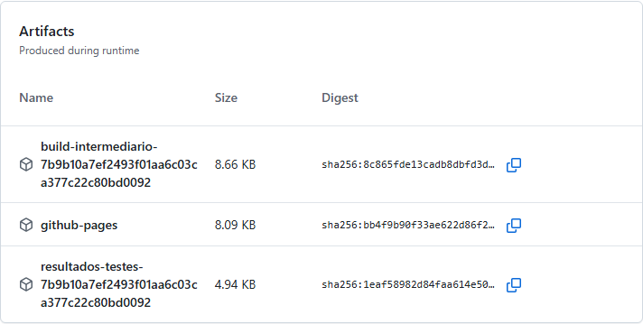<figcaption>Figura 7 — Artefatos da execução de recuperação, incluindo o pacote final github-pages, após aprovação dos testes. A imagem é da interface pública real do GitHub.</figcaption></figure>

# 9. Simulação de falha, bloqueio e recuperação

## 9.1 Estado inicial aprovado

A execução [45315409008](https://github.com/EduardoCaversan/ecowatt/actions/runs/45315409008), disparada por push na main, aprovou Build, Test, Package e Deploy. O commit publicado foi `0a27562758e50f421e965f922e5cc7fb9a1c5b2f`. A consulta pública inicial e a execução dos testes de interface foram concluídas antes da alteração proposital da regra.

O estado inicial observou 180 kWh para o aquecedor e 225 kWh para o cenário C. O arquivo `evidencias/publicacao/inicial/version.json` preserva exatamente os metadados consultados nessa etapa. O valor de SHA foi usado como referência para detectar qualquer publicação indevida durante a falha.

## 9.2 Regressão real e verificações no PR

Na branch `demo/pipeline-failure`, o commit `677a1a3fc7a3e29cba481149be888292ea8ad242` alterou somente a constante do período na função real `monthlyConsumption`, de 30 para 31 dias. Os testes originais permaneceram intactos.

```javascript
// Regra correta no estado inicial:
const consumption = (powerWatts / 1000) * dailyHours * quantity * 30;
// Regra propositalmente incorreta no commit de demonstração:
const consumption = (powerWatts / 1000) * dailyHours * quantity * 31;
```

O [PR #4](https://github.com/EduardoCaversan/ecowatt/pull/4) registrou a falha nas verificações. O build foi aprovado porque a alteração era sintaticamente válida. O teste T01, que utiliza a função de produção, esperava 180 e recebeu 186. Não foi utilizado comando artificial de saída, alteração de assertion ou indisponibilidade externa como mecanismo de falha.

Antes da integração controlada, foram verificados Pages por workflow, um único workflow ativo, ausência de proteções/regras existentes na main e preservação da versão anterior. Nenhuma proteção foi removida ou contornada. A integração de um PR reprovado foi uma exceção deliberada desta demonstração acadêmica isolada, não um processo recomendado para alterações ordinárias.

## 9.3 Falha na main e bloqueio efetivo

O merge do PR gerou o commit `e4e229bc9989aefc83fa4268c441075e5e2f53eb` na main e disparou a execução [45316735655](https://github.com/EduardoCaversan/ecowatt/actions/runs/45316735655). Essa execução seria elegível para deploy caso passasse nos testes: o evento era push e a referência era main. Portanto, o bloqueio não foi explicado apenas pela condição de PR ou por outra branch.

<figure class="figure-small">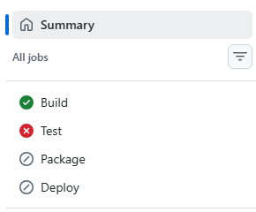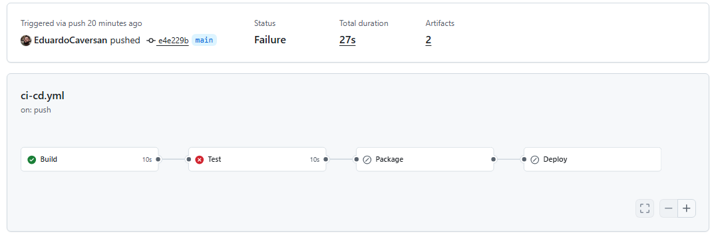<figcaption>Figura 8 — Execução reprovada na main. Build concluiu com sucesso, Test falhou e Package/Deploy foram ignorados por dependência. Fonte: interface real do GitHub Actions.</figcaption></figure>

O Vitest executou 19 testes: 9 falharam e 10 passaram. O resultado T01 foi **esperado: 180; obtido: 186**. O job Test terminou reprovado. Seu step de upload preservou os relatórios, mas os steps normais posteriores, incluindo a interface, não prosseguiram. Package e Deploy ficaram com conclusão `skipped`.

O run reprovado preservou o build intermediário e os resultados de teste. Não gerou `github-pages`. Essa distinção é essencial: a existência de um build não implica que a versão passou no controle de qualidade ou foi publicada.

O detalhamento integral das assertions consta em `evidencias/runs/falha/logs.txt` e no JSON/JUnit baixado. A interface pública do GitHub permite visualizar o resumo, mas exige login para detalhar os logs. A coleta autenticada via CLI preservou o conteúdo real; essa limitação de captura visual é declarada e não foi substituída por uma imagem simulada do GitHub. A Figura 9 mostra o arquivo JUnit original aberto no Chromium local, com a assertion de 180 versus 186 e o total de nove falhas. Os recortes das figuras preservam o conteúdo e a proporção das interfaces; as capturas integrais permanecem nas evidências.

<figure class="figure-small">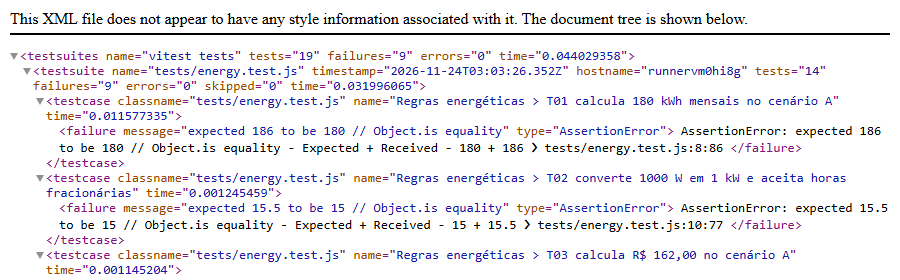<figcaption>Figura 9 — Captura da visualização local do JUnit original exportado do run reprovado. Não é a tela de logs autenticada do GitHub. O arquivo completo acompanha a entrega e permite inspecionar as nove assertions reprovadas.</figcaption></figure>

Após a falha, uma nova consulta sem cache retornou o mesmo SHA inicial `0a27562758e50f421e965f922e5cc7fb9a1c5b2f`. Os registros `evidencias/publicacao/durante-falha/version.json` e `http.json` documentam o horário, status 200 e igualdade do SHA. A verificação de navegador contra a publicação continuou a obter 180 kWh. Assim, o commit defeituoso da main não substituiu a versão anterior no Pages.

## 9.4 Correção e recuperação

Na branch `fix/monthly-consumption`, o commit `cfe9f3da1749fb0fc8b89a7e531db16a8b1d401e` restaurou 30 dias. Os arquivos de teste não foram alterados. Os testes locais foram executados novamente e aprovados. O [PR #5](https://github.com/EduardoCaversan/ecowatt/pull/5) aprovou suas verificações e foi integrado com merge commit `7b9b10a7ef2493f01aa6c03ca377c22c80bd0092`.

A execução [45318646338](https://github.com/EduardoCaversan/ecowatt/actions/runs/45318646338), produzida pelo push desse commit na main, aprovou os quatro jobs. O pacote final foi gerado e publicado. A consulta pública passou a apresentar o SHA corrigido e o identificador desse run. Os testes de interface públicos aprovaram os cenários numéricos e a correspondência com o rodapé.

| Cenário na main | Build | Test | Package | Deploy | Commit |
|---|---|---|---|---|---|
| Inicial | success | success | success | success | `0a27562` |
| Regressão | success | failure | skipped | skipped | `e4e229b` |
| Recuperação | success | success | success | success | `7b9b10a` |

<figure class="figure-small">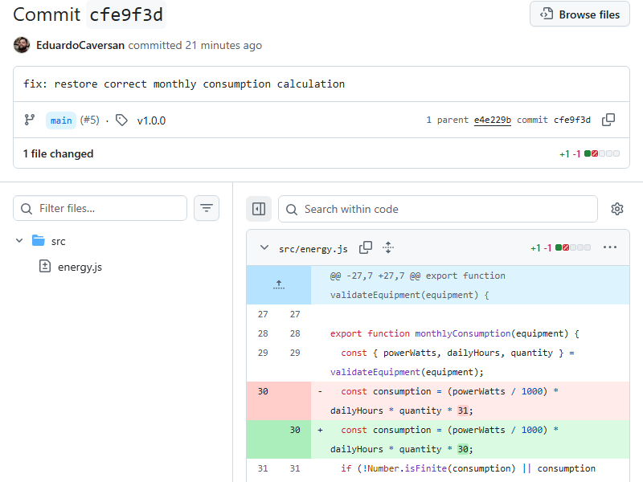<figcaption>Figura 10 — Commit real de correção: restauração de 31 para 30 dias. Os testes originais foram preservados, permitindo verificar o restabelecimento do comportamento.</figcaption></figure>

O histórico conserva **SUCCESS → FAILURE → SUCCESS** em três commits e três execuções distintas de produção. Nenhuma execução foi apagada e a recuperação não consistiu em reexecutar um commit antigo. O estado final da main contém a regra correta. O processo demonstra que o teste protegeu uma expectativa funcional conhecida e que a dependência do pipeline impediu uma entrega incorreta ao usuário.

# 10. Resultado final e rastreabilidade

| Elemento | Identificação verificável |
|---|---|
| Repositório | [EduardoCaversan/ecowatt](https://github.com/EduardoCaversan/ecowatt) |
| Aplicação | [GitHub Pages — EcoWatt](https://eduardocaversan.github.io/ecowatt/) |
| Versão / tag | [v1.0.0](https://github.com/EduardoCaversan/ecowatt/tree/v1.0.0) |
| Commit inicial publicado | `0a27562758e50f421e965f922e5cc7fb9a1c5b2f` |
| Commit de origem da regressão | `677a1a3fc7a3e29cba481149be888292ea8ad242` |
| Commit defeituoso integrado na main | `e4e229bc9989aefc83fa4268c441075e5e2f53eb` |
| Commit de origem da correção | `cfe9f3da1749fb0fc8b89a7e531db16a8b1d401e` |
| Commit corrigido publicado / tag | `7b9b10a7ef2493f01aa6c03ca377c22c80bd0092` |
| Run inicial | [45315409008](https://github.com/EduardoCaversan/ecowatt/actions/runs/45315409008) |
| Run com falha | [45316735655](https://github.com/EduardoCaversan/ecowatt/actions/runs/45316735655) |
| Run recuperado | [45318646338](https://github.com/EduardoCaversan/ecowatt/actions/runs/45318646338) |
| Artefato final | github-pages, ID 14885569757 |
| Pull requests | [#1](https://github.com/EduardoCaversan/ecowatt/pull/1), [#2](https://github.com/EduardoCaversan/ecowatt/pull/2), [#3](https://github.com/EduardoCaversan/ecowatt/pull/3), [#4](https://github.com/EduardoCaversan/ecowatt/pull/4), [#5](https://github.com/EduardoCaversan/ecowatt/pull/5) |

Conteúdo efetivamente consultado em `version.json` após a recuperação:

```json
{
  "version": "1.0.0",
  "commit": "7b9b10a7ef2493f01aa6c03ca377c22c80bd0092",
  "builtAt": "2026-11-24T03:19:17.555Z",
  "runId": "45318646338",
  "dirty": false
}
```

A cadeia **Código → Commit → Build → Testes → Artefato → Publicação** pode ser percorrida pelo SHA do run, pelo checkout, pelo nome do build intermediário, pelos resultados associados à mesma execução e pelo conteúdo de `version.json`. Os hashes dos arquivos são verificados nos jobs e a versão pública é comparada ao commit esperado.

Em PRs, o checkout padrão valida o commit de integração temporário do GitHub, que pode diferir do head da branch. As três execuções da tabela são pushes na main; seus SHAs representam commits efetivamente integrados. Essa distinção evita atribuir ao produto publicado o SHA de um merge temporário de PR.

O pacote de entrega contém PDF, código-fonte em ZIP, evidências, links e material separado de apresentação. O ZIP foi extraído e verificado com instalação, testes e build; o registro está na pasta externa de evidências da entrega. Os artefatos do Actions têm retenção configurada de 90 dias, sujeita à política do serviço; cópias baixadas acompanham a entrega. Os links do histórico permanecem úteis, mas a disponibilidade futura do serviço não é uma propriedade controlada pelo projeto.

# 11. Dificuldades, decisões e aprendizados

## 11.1 Ocorrências verificadas

**GitHub CLI ausente.** A inspeção inicial não encontrou `gh` no PATH. Uma distribuição oficial foi instalada em diretório de ferramentas da tarefa. A credencial Git já existente permitiu autenticação em memória, sem gravar tokens no repositório. O conector GitHub reconhecia a conta, mas retornou 403 ao criar PR; o CLI autenticado foi usado para as operações necessárias.

**Restrição local de processos e rede.** A primeira tentativa do Vitest encontrou `spawn EPERM` no sandbox, e consultas NPM estavam em modo sem rede. As execuções autorizadas com criação de processos e rede concluíram. Esse erro de ambiente não foi usado como regressão acadêmica e não foi contabilizado como teste funcional reprovado do cenário B.

**Transbordamento móvel.** O teste UI02 detectou largura de página superior ao viewport. A inspeção do DOM identificou um texto de acessibilidade posicionado de forma absoluta dentro da tabela. O contêiner rolável recebeu posicionamento relativo, mantendo o elemento no contexto correto. A verificação voltou a passar. O JSON da investigação foi preservado em `evidencias/investigacao/`.

**Captura transitória do Chromium.** Uma tentativa de screenshot retornou erro de protocolo, sem apontar falha de cálculo. A execução subsequente concluiu as capturas e os cinco testes. Não foram habilitados retries de testes ou ignoradas assertions para obter aprovação.

**Retenção dos relatórios.** A inspeção do artefato inicial revelou que o Playwright limpava a pasta compartilhada com o Vitest. O commit `d513874` mudou somente o diretório de saída de execução do navegador para `test-results/browser`. Os testes originais permaneceram intactos. A execução final confirmou a presença de `unit.json`, `unit.xml`, `ui.json` e `ui.xml`; a ausência dos arquivos unitários no artefato inicial não foi ocultada.

**Logs públicos e evidências.** As páginas públicas do GitHub mostraram jobs e artefatos, porém o detalhamento dos logs exigiu login. Os logs e relatórios foram baixados pela API/CLI autenticada. O documento distingue essas fontes e não utiliza telas artificiais para preencher a limitação.

## 11.2 Decisões e conceitos demonstrados

A separação entre regras, armazenamento e interface permitiu testar cálculos sem navegador e testar a experiência real em outra camada. O lockfile reduziu variações de instalação. O build único com hashes impediu que Package reconstruísse um estado diferente do validado. O `paths-ignore` evitou a necessidade de republicar a aplicação a cada correção documental.

A regressão ilustra a diferença entre código compilável e comportamento correto. A falha do teste não é apenas um aviso: a estrutura do workflow transforma o resultado em uma barreira efetiva à entrega. A consulta do SHA público acrescenta evidência externa ao status do job.

Essas são observações técnicas verificadas durante a execução. Reflexões pessoais sobre aprendizado, dificuldades sentidas ou domínio do conteúdo precisam ser redigidas ou confirmadas pelo acadêmico após revisão. Não se presume que o uso da automação, isoladamente, demonstre sua compreensão individual.

# 12. Considerações finais

O EcoWatt foi desenvolvido como aplicação estática funcional, com cadastro, consulta, tarifa configurável, consumo e custo mensais, indicadores, distribuição proporcional, exclusão confirmada e persistência validada. A interface foi verificada em desktop e mobile, com cenários numéricos definidos e tratamento explícito de entradas inválidas e problemas de armazenamento.

O controle de versão preserva incrementos reais, branches e PRs integrados. O pipeline executa build, testes, preparação do pacote e deploy em jobs dependentes. A publicação foi verificada no GitHub Pages, e o arquivo de versão relaciona o produto público ao commit e à execução que o entregaram.

A demonstração alcançou três estados observáveis: publicação inicial aprovada, regressão detectada com bloqueio da entrega e recuperação publicada após correção. Durante a falha, o SHA público permaneceu no estado anterior. Essa evidência atende ao objetivo pedagógico central de mostrar uma prevenção real de regressão na entrega, além da existência de testes automatizados.

As limitações de produto permanecem explícitas: os dados se restringem ao navegador, não há sincronização entre dispositivos, medição física ou integração com concessionárias. A estimativa utiliza potência constante, média de horas informada, mês fixo de 30 dias e tarifa manual. Não modela impostos, bandeiras, faixas tarifárias, consumo variável nem ciclos de equipamentos.

Como melhorias futuras, poderiam ser avaliados exportação/importação local dos dados, edição de equipamentos e perfis de utilização. Essas possibilidades não foram implementadas porque não eram necessárias para demonstrar a confiabilidade do ciclo de entrega. Qualquer ampliação deve manter a rastreabilidade e novos testes para as regras introduzidas.

O documento e o pacote foram preparados para revisão e entrega, não para substituir as responsabilidades acadêmicas. Permanecem dependentes de Eduardo Caversan: confirmação do tema, preenchimento de RA/turma/campus, conferência dos dados, revisão pessoal do código e relatório, preparação da apresentação e envio ao Moodle. A apresentação ainda não foi realizada e não recebeu avaliação fictícia neste documento.

# 13. Referências e declaração de uso de ferramentas

## 13.1 Referências consultadas

As referências abaixo são documentação oficial efetivamente consultada durante a execução. Data de acesso: **23/11/2026** (horário local de São Paulo).

1. GIT. *git-merge Documentation*. Disponível em: [https://git-scm.com/docs/git-merge](https://git-scm.com/docs/git-merge).
2. GITHUB. *Using custom workflows with GitHub Pages*. Disponível em: [documentação de workflows do Pages](https://docs.github.com/en/pages/getting-started-with-github-pages/using-custom-workflows-with-github-pages).
3. GITHUB. *Using jobs in a workflow*. Disponível em: [documentação de jobs e dependências](https://docs.github.com/en/actions/how-tos/write-workflows/choose-what-workflows-do/use-jobs).
4. GITHUB. *Events that trigger workflows*. Disponível em: [eventos do GitHub Actions](https://docs.github.com/en/actions/reference/workflows-and-actions/events-that-trigger-workflows).
5. GITHUB ACTIONS. *checkout, setup-node e upload-artifact*. Disponíveis em: [checkout](https://github.com/actions/checkout), [setup-node](https://github.com/actions/setup-node) e [upload-artifact](https://github.com/actions/upload-artifact). Releases das demais actions também foram consultadas na API oficial do GitHub.
6. NODE.JS. *Node.js Releases*. Disponível em: [https://nodejs.org/en/about/previous-releases](https://nodejs.org/en/about/previous-releases).
7. NPM. *npm ci*. Disponível em: [https://docs.npmjs.com/cli/v10/commands/npm-ci/](https://docs.npmjs.com/cli/v10/commands/npm-ci/).
8. VITE. *Getting Started*. Disponível em: [https://vite.dev/guide/](https://vite.dev/guide/).
9. VITEST. *Getting Started*. Disponível em: [https://vitest.dev/guide/](https://vitest.dev/guide/).
10. MDN WEB DOCS. *Window: localStorage property*. Disponível em: [https://developer.mozilla.org/en-US/docs/Web/API/Window/localStorage](https://developer.mozilla.org/en-US/docs/Web/API/Window/localStorage).
11. MDN WEB DOCS. *Intl.NumberFormat*. Disponível em: [https://developer.mozilla.org/en-US/docs/Web/JavaScript/Reference/Global_Objects/Intl/NumberFormat](https://developer.mozilla.org/en-US/docs/Web/JavaScript/Reference/Global_Objects/Intl/NumberFormat).
12. PLAYWRIGHT. *Assertions*. Disponível em: [https://playwright.dev/docs/test-assertions](https://playwright.dev/docs/test-assertions).

## 13.2 Declaração de uso de inteligência artificial e automação

Foram utilizadas ferramentas de inteligência artificial da OpenAI, no ambiente ChatGPT/Codex, com participação direta na organização técnica, implementação de HTML/CSS/JavaScript, testes Vitest e Playwright, configuração e execução de Git/PRs e CI/CD, investigação de falhas, coleta de evidências e elaboração do README, relatório e materiais de revisão. Não se restringiu o uso de IA à formatação.

Foi utilizado o Codex no ambiente ChatGPT da OpenAI. A identificação “Astra High” deve ser conferida pelo acadêmico na interface: não foi possível verificar de forma independente o modelo/modo exato selecionado. A declaração registra a contribuição efetiva dessas ferramentas sem presumir uma sessão adicional de ChatGPT anterior a este trabalho ou atribuir um modelo não confirmado.

As ferramentas operacionais incluíram Git, GitHub CLI/API, NPM, Vite, Vitest, Playwright/Chromium e Python. As imagens são capturas de interfaces reais da aplicação e do GitHub; não foram geradas por IA nem desenhadas como simulações de resultados. Logs, metadados e resultados estruturados registram execuções reais.

Cabe ao acadêmico revisar, validar e compreender o código, as configurações, a demonstração e o documento antes de entregar e apresentar. O apoio das ferramentas não transfere a responsabilidade acadêmica nem comprova automaticamente autoria intelectual exclusiva, revisão pessoal ou domínio do conteúdo.
